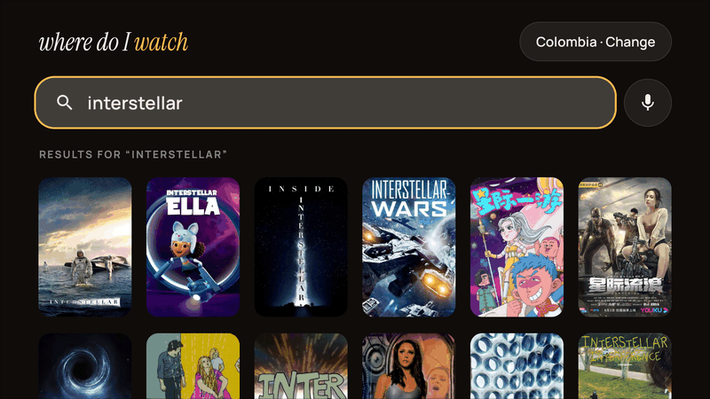
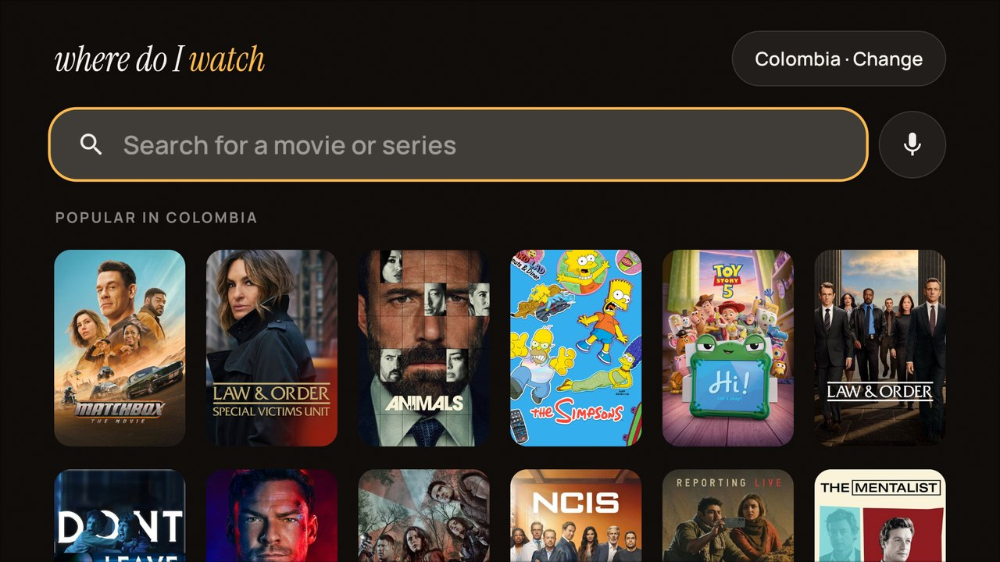
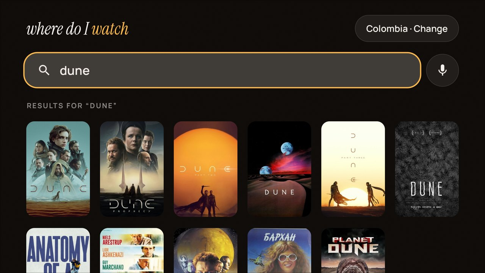
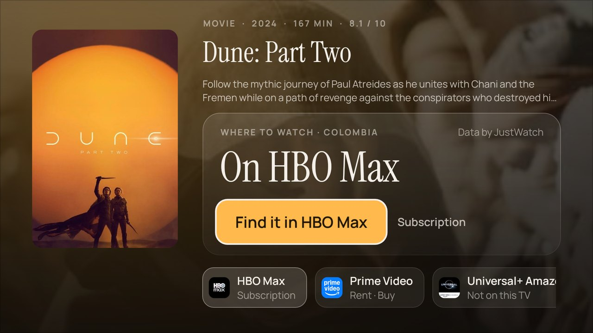

# Where Do I Watch (WDIW)

One search on your Android TV that tells you which streaming app has a movie or series in your country, and opens it there.

Where Do I Watch does not stream anything. It finds where a title is legally available and hands you to the app you already have.

**Website:** [darien-o.github.io/wdiw](https://darien-o.github.io/wdiw) · **Download:** [latest APK](https://github.com/darien-o/wdiw/releases/latest)

<p align="center">
  
</p>

<table>
  <tr>
    <td></td>
    <td></td>
    <td></td>
  </tr>
  <tr>
    <td align="center">Popular where you are</td>
    <td align="center">Movies and series in one search</td>
    <td align="center">Where it streams, and one press to open it</td>
  </tr>
</table>

> **Status: early.** The app builds, its logic is tested and it runs on a real Android TV device. Only some streaming app links have been confirmed on a device so far; see [`registry/verified.md`](registry/verified.md).

## How it works

1. You search by remote or by voice.
2. The app asks a small proxy, which asks [TMDB](https://www.themoviedb.org) what the title is and where it can be watched in your country, and [Wikidata](https://www.wikidata.org) for the title's ID on each platform.
3. The app checks which of those streaming apps are installed on the TV.
4. Pressing OK opens the title in the app. When the app does not support that, Where Do I Watch opens the app's search for the title, or just the app. When the app is not installed, it shows a QR code for your phone.

The rules for opening each streaming app live in [`registry/providers.json`](registry/providers.json), which the app downloads on start. Fixing a link or adding a provider is a change to that file, with no app update.

## Repository layout

| Folder | What it is |
|---|---|
| [`android-tv/`](android-tv) | The TV app (Kotlin, Compose for TV) |
| [`registry/`](registry) | Which app each provider is and how to open titles in it |
| [`proxy/`](proxy) | Cloudflare Worker that hides the TMDB key, caches answers and serves the registry |
| [`web/`](web) | Phone website (planned) |
| [`docs/`](docs) | Architecture, adding a provider, releasing |
| [`site/`](site) | The project website, published with GitHub Pages |

## Running it yourself

You need a free [TMDB API key](https://www.themoviedb.org/settings/api) (use the "API Read Access Token").

**Proxy**

```sh
cd proxy
pnpm install
echo 'TMDB_TOKEN=<your token>' > .dev.vars
pnpm dev          # serves http://localhost:8787
```

**TV app** (JDK 17 or newer and the Android SDK)

```sh
cd android-tv
./gradlew installDebug      # debug builds talk to the proxy on the machine running the emulator
```

For a real TV, pass the proxy's address: `./gradlew installDebug -PproxyUrl=http://<your computer's IP>:8787`.

Tests: `pnpm test` in `proxy/`, `./gradlew testDebugUnitTest` in `android-tv/`.

## Talking to the app from outside

Assistants and automations can drive the app with links:

```sh
adb shell am start -a android.intent.action.VIEW -d "wdiw://search?q=inception"
adb shell am start -a android.intent.action.VIEW -d "wdiw://title/movie/27205"
```

It also answers the TV's own search, so titles can show up when you search from the launcher.

## Contributing

The most useful contribution is testing a streaming app's links on your TV: see [`docs/adding-a-provider.md`](docs/adding-a-provider.md). For everything else see [`CONTRIBUTING.md`](CONTRIBUTING.md).

## Credits and terms

- This product uses the TMDB API but is not endorsed or certified by TMDB.
- Streaming availability data is provided by [JustWatch](https://www.justwatch.com) through TMDB.
- TMDB's API is free for non-commercial use only, so this project carries no ads and cannot be sold.
- Fonts: Instrument Serif and Manrope, both under the SIL Open Font License (see [`licenses/`](licenses)).

Licensed under the [GNU General Public License v3.0](LICENSE).
